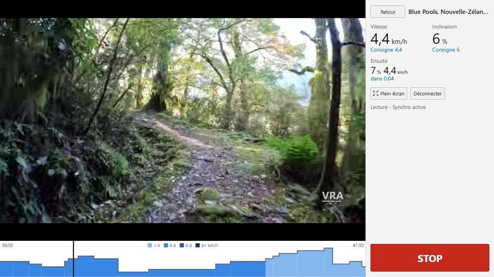
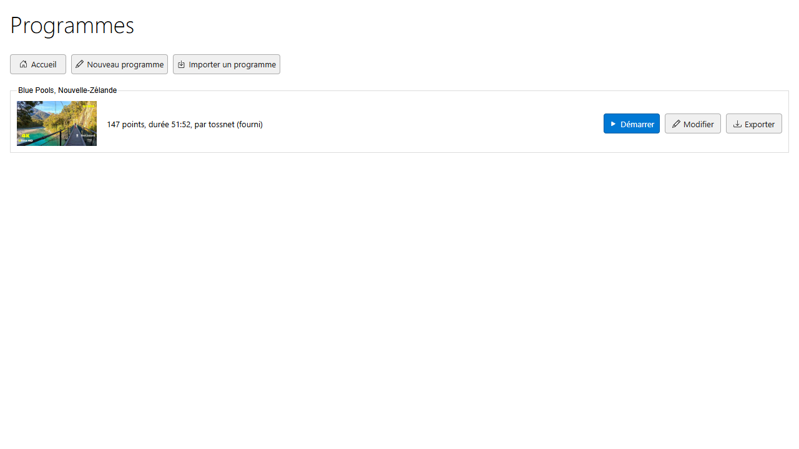
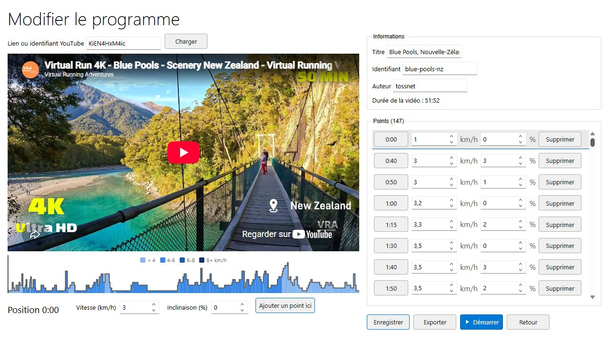

# TrailFtms

**English** | [Français](README.fr.md)

[](https://github.com/tossnet/TrailFtms/actions/workflows/deploy.yml)
[](LICENSE)

Control your FTMS treadmill to the beat of a YouTube video. Blazor WebAssembly + Web Bluetooth.

**Open the app: <https://tossnet.github.io/TrailFtms/>**



Each YouTube video comes with a **program**: the speed and incline to apply at each moment of the
video. While the video plays, TrailFtms sends these targets to your treadmill over Bluetooth, so the
belt climbs when the trail climbs. 100 % in the browser: no account, no backend, nothing to install.

> [!WARNING]
> **Safety first.** TrailFtms drives a machine automatically.
> - **Always clip the treadmill safety key to your clothes**: it is the only stop that works even if
>   the app or the Bluetooth link stops responding.
> - The **STOP** button (or the **Space** / **Escape** keys) stops the belt and the video at any time.
> - Set a maximum speed and incline that suit you in the settings.
> - The software is provided "as is", without warranty of any kind (see the [license](LICENSE)).
>   You use it at your own risk.

## Getting started

1. Open the app in **Chrome or Edge** (see [browser support](#browser-support)).
2. Turn the treadmill on, clip the safety key, and make sure no other device (phone app, another tab)
   is connected to it: the treadmill accepts a single Bluetooth connection.
3. On the home page, **Connecter le tapis** (connect the treadmill) and pick it in the browser list
   (`FS-xxxxxx` for FitShow modules). The speed and incline ranges read from the treadmill are displayed.
4. **Programmes**, then **Démarrer** (start) on a program, then play the video. The belt starts when
   the video really plays (not during the initial loading or an ad).

The interface is in French for now. The labels below are quoted as they appear in the app.

## Features

- **The video drives the treadmill.** The app reads the video time 4 times per second and sends a
  command only when the target changes. Everything follows the video time, never a clock: ads,
  buffering and seeks keep the treadmill in sync.
- **Ride screen** made for a tablet on the treadmill: landscape or portrait, actual speed and incline
  with their targets, next change with countdown, incline profile colored by speed that scrolls
  with the video on long routes (tap a segment to jump to it), full screen.
- **Safety**: always visible STOP button and keyboard shortcut, sync halted on a lost connection,
  the safety key or a stop from the console (nothing restarts without you), user ceilings applied
  to every command, safety notice on first launch.
- **Video paused**: keep going, slow down to a walking speed (default), or pause the belt.
- **End of the video**: incline back to 0 step by step, then speed down to the minimum, then stop.
- **Program editor**: play the video and press **Ajouter un point ici** (add a point here) at each
  change of slope or pace. Save in the browser, export as JSON, share.
- **Manual control** from the home page: speed, incline, start, pause, stop.
- Classic Windows 10 look (touch mode) with [Blazor-WinOld](https://github.com/tossnet/Blazor-WinOld),
  light and dark themes on the ride screen. Interface in French, ready for translation.

| Programs | Editor |
|---|---|
|  |  |

## Browser support

TrailFtms relies on the [Web Bluetooth API](https://developer.mozilla.org/docs/Web/API/Web_Bluetooth_API).

| Platform | Chrome / Edge | Firefox | Safari |
|---|---|---|---|
| Windows, macOS, ChromeOS | Yes | No | No |
| Android | Yes | No | |
| Linux | Experimental (may need `chrome://flags`) | No | |
| iPhone / iPad | No (all iOS browsers use WebKit, without Web Bluetooth) | No | No |

The app shows a clear message when the browser has no Web Bluetooth. If the browser blocks site data,
the app still works but forgets the settings and imported programs on reload.

## Tested treadmills

| Treadmill | Bluetooth module | Speed | Incline | Status |
|---|---|---|---|---|
| CARE Run-18 | FitShow (`FS-xxxxxx`) | 1.0 to 18.0 km/h, step 0.1 | 0 to 15 %, step 1 | Works |

Notes on the CARE Run-18:
- the treadmill beeps on every command it receives (firmware behavior, it cannot be turned off from
  the app). A program with fewer points means fewer beeps;
- it splits its measurements over several Bluetooth notifications, which the app merges.

Any treadmill implementing the Bluetooth **Fitness Machine Service** (FTMS) with speed and incline
targets should work. Tried yours? Please [open an issue](https://github.com/tossnet/TrailFtms/issues)
with the model, the Bluetooth module name and the ranges shown on the home page, whether it works or not.

## Programs

A program is a small JSON file:

```json
{
  "id": "blue-pools-nz",
  "title": "Blue Pools, Nouvelle-Zélande",
  "youtubeId": "KiEN4HxM4ic",
  "author": "tossnet",
  "durationSeconds": 3112,
  "segments": [
    { "t": 0,  "speed": 1, "incline": 0 },
    { "t": 40, "speed": 3, "incline": 3 },
    { "t": 50, "speed": 3, "incline": 1 }
  ]
}
```

- `t` is the video time in seconds. Each segment applies until the next one.
- `speed` in km/h, `incline` in %. They are multiplied by the pace setting, capped by your ceilings,
  then by the treadmill ranges, and rounded to the treadmill step before being sent.
- The first segment starts at `0`; times are unique and before the end of the video.

### Contribute a program

1. In the app: **Programmes > Nouveau programme** (new program), paste the YouTube link, play the
   video and add a point at each change of slope or pace. **Enregistrer** (save), then **Exporter** (export).
2. Add the file to [`src/TrailFtms/wwwroot/programs/`](src/TrailFtms/wwwroot/programs/). The file name
   is the program `id` (lowercase letters, digits and hyphens), for example `my-trail.json`.
3. Add the file name to [`index.json`](src/TrailFtms/wwwroot/programs/index.json) in the same folder.
4. Open a pull request. The CI checks that every shipped program is valid.

Only programs for videos whose owner allows embedding work (otherwise the app says so).

## Development

Requirements: [.NET 10 SDK](https://dotnet.microsoft.com/download).

```bash
dotnet run --project src/TrailFtms   # then open the URL shown, in Chrome or Edge
dotnet test                          # MSTest + bUnit
```

| Folder | Contents |
|---|---|
| `src/TrailFtms/Services/Bluetooth` | FTMS protocol (pure C#, fully tested) and the treadmill service |
| `src/TrailFtms/Services/Ride` | `RideEngine`: video time to treadmill targets |
| `src/TrailFtms/Services/Video` | YouTube IFrame player |
| `src/TrailFtms/Services/Programs` | Program model, validation, store, editor draft |
| `src/TrailFtms/wwwroot/js` | Thin JavaScript interop (Web Bluetooth, YouTube, storage) |
| `tests/TrailFtms.Tests` | Unit and component tests, with a simulated treadmill |

Every push to `main` is tested, published and deployed to GitHub Pages by
[`deploy.yml`](.github/workflows/deploy.yml).

## Ideas for later

- The treadmill drives the video (playback speed follows your pace).
- Generate a program from a GPX track or GoPro GPS data.
- Export the session (FIT / TCX) to Strava.
- Community list of tested treadmills.

## Credits

- [Blazor-WinOld](https://github.com/tossnet/Blazor-WinOld) for the user interface.
- [Bootstrap Icons](https://icons.getbootstrap.com) (MIT) for the few icons used.
- The Blue Pools program follows the video
  [Virtual Run 4K - Blue Pools](https://www.youtube.com/watch?v=KiEN4HxM4ic) by Virtual Running
  Adventures, played with the official YouTube player.

## License

[MIT](LICENSE) © 2026 Christophe Peugnet
